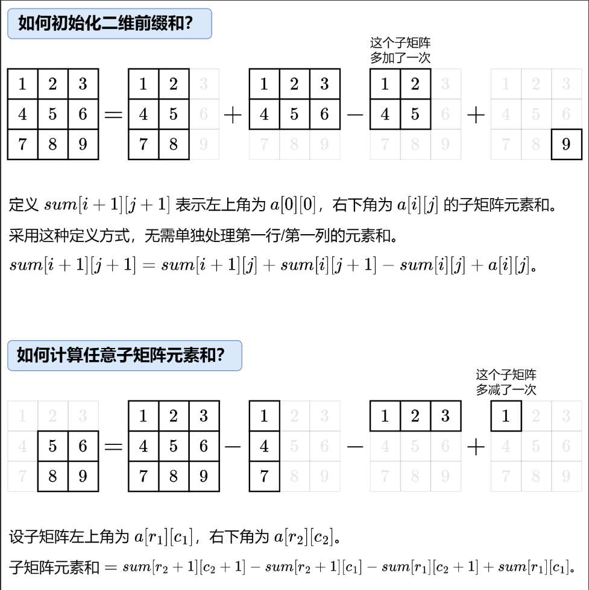

# 前缀和

## 1.1基础

>输入整数$n,q(1<=n,q<=10^5)$,和长为$n$的数组$a$。
>接下来$q$行，每行输入两个数$l,r(1<=l<=r<=n)$，要求输出区间$[l,r]$内所有元素的和，即$\sum_{i=l}^{r} a_i$。

>[!CAUTION]
>题目描述一般都是1下标，笔者写代码一般都是0下标，故本文所有题目描述均采用1下标，代码部分均为0下标。0下标指将数组第一个元素放到$a[0]$,1下标指将第一个元素放到$a[1]$,将$a[0]$空出来

暴力做法就是对于每一个询问，遍历$l$到$r$求和，但这样时间复杂度是$O(nq)$,最坏情况下会超时。

这里介绍一下前缀和算法，前缀和是一种常用的算法预处理技巧，通过提前计算数组前若干个元素的累加和，实现快速的区间求和。

注意到
$$
\sum_{i=l}^{r} a_i = \sum_{i=0}^{r} a_i - \sum_{i=0}^{l-1} a_i。
$$

任意一个区间和，都可以转换为两个前缀和相减。
我们可以先预处理所有的前缀和，进而$O(1)$ 的求出所有区间和，总时间复杂度$O(n + q)$，空间复杂度$O(n)$。

记 $s[i]表示前i个数的和$
$$
\begin{aligned}
s[0] &= 0\\
s[1] &= a[0]\\
s[2] &= a[0]+a[1]\\
&\mathrel{\vdots}\\
s[n] &= a[0]+a[1]+\cdots+a[n-1]
\end{aligned}
$$
则有 $\sum_{i=l}^{r} a_i = s[r + 1] - s[l]$

>[!TIP]
>这里定义$s[0] = 0$，表示前0个数的和为0，避免$l=0$时需要特判。

**例**:
$$
    a = [1,3,2,5,4]
$$
对应前缀和数组为
$$
    s = [0,1,4,6,11,15]
$$
查询区间$[1,3]$的区间和
$$
    a[1] + a[2] + a[3] = 3 + 2 + 5 = 10 = s[4] - s[1]
$$

<iframe
  src="/learning-notes/demos/prefix-sum.html"
  width="100%"
  height="500"
  style="border: none; border-radius: 16px;"
></iframe>

**代码**

```cpp

#include <bits/stdc++.h>
using namespace std;
using ll = long long;
int main()
{
    int n,q;
    cin >> n >> q;
    vector<int> a(n);
    for (int i = 0;i < n;i++) cin >> a[i];
    vector<ll> s(n + 1);
    for (int i = 0;i < n;i++) s[i + 1] = s[i] + a[i];
    while (q--) 
    {
        int l,r;
        cin >> l >> r;
        l--;r--;
        cout << s[r + 1] - s[l] << endl;
    }
}
```

>[!TIP]
>提示：除了加法以外，还有一些操作也可以运用这种前缀思想，例如前缀异或和，前缀max/min等

**课后练习**
1.[洛谷P8218求区间和](https://www.luogu.com.cn/problem/P8218)
2.[LeetCode 724寻找数组中心下标](https://leetcode.cn/problems/find-pivot-index/description/)
3.[LeetCode 3427变长子数组求和](https://leetcode.cn/problems/sum-of-variable-length-subarrays/description/)
4.[LeetCode 1310子数组异或查询](https://leetcode.cn/problems/xor-queries-of-a-subarray/description/)
5.[CodeForces 1539B](https://codeforces.com/problemset/problem/1539/B)

## 1.2二维前缀和

>输入$n,m,q(1<=n,m,q<=10^5,1<=n*m<=10^5)$和一个$n*m$的矩阵，接下来$q$行，每行给出一个矩阵的左上角和右下角坐标。
>输出$q$行，每行一个整数，表示这个矩阵的和

暴力做法是遍历每个查询的矩阵，时间复杂度$O(nmq)$，会超时。

按照之前一维前缀和的思路，这里可以用二维前缀和，具体见下图。时间复杂度$O(nm + q)$。



**代码**

```cpp

#include<bits/stdc++.h>
using namespace std;
using ll = long long;
int main()
{
    int n,m,q;
    cin >> n >> m >> q;
    vector<vector<int>> a(n,vector<int>(m));
    for (int i = 0;i < n;i++)
    {
        for (int j = 0;j < m;j++)
        {
            cin >> a[i][j];
        }
    }
    vector<vector<ll>> pre(n + 1,vector<ll>(m + 1));//这里pre对应图中sum
    //预处理 时间复杂度O(nm)
    for (int i = 0;i < n;i++)
    {
        for (int j = 0;j < m;j++) 
        {
            pre[i + 1][j + 1] = pre[i + 1][j] + pre[i][j + 1] - pre[i][j] + a[i][j];
        }
    }
    //q次询问，每次询问O(1)查询，时间复杂度O(q)
    while (q--)
    {
        int x1,x2,y1,y2;
        cin >> x1 >> y1 >> x2 >> y2;//(x1,y1)对应左上角坐标,(x2,y2)对应右下角坐标
        x1--;y1--;x2--;y2--;
        ll ans = pre[x2 + 1][y2 + 1] - pre[x2 + 1][y1] - pre[x1][y2 + 1] + pre[x1][y1];
        cout << ans << endl;
    }
}

```

**课后练习**
1.[LeetCode 304 二维区域和检索](https://leetcode.cn/problems/range-sum-query-2d-immutable/description/)
2.[LeetCode 1314 矩阵区域和](https://leetcode.cn/problems/matrix-block-sum/description/)
3.[洛谷P2004 领地选择](https://www.luogu.com.cn/problem/P2004)
4.[洛谷P1387 最大正方形](https://www.luogu.com.cn/problem/P1387)

## 1.3前缀和与哈希表

>$输入n(1<=n<=10^5),k(-10^7<=k<=10^7)和一个长为n的数组a(-1000<=a[i]<=1000),$
$输出数组中和为k的子数组个数.$

暴力做法是统计所有子数组的和，如果和为$k$，$ans++$，最后输出$ans$，时间复杂度$O(n^2)$。

>[!TIP]
>长为n的数组一共有$\frac{n*(n+1)}{2}$个。
>当左端点为1时，右端点可以为$1,2,...,n$，总共$n$个子数组
>当左端点为2时，右端点可以为$2,3,...,n$，总共$n-1$个子数组
>当左端点为n时，右端点可以为$n$，总共>$1$个子数组
故总共有$\sum_{i=1}^{n} i = \frac{n*(n+1)}{2}$个子数组

根据我们刚刚求区间和的思路，我们需要求满足$s[r + 1] - s[l] == k$的不同$(l,r)$的数量。即求$s[r + 1] - k == s[l]$的$(l,r)$数量，我们可以创建一个哈希表用来统计数量，接着我们遍历前缀和数组，假设遍历到下标$i$,记$x = s[i]$,则满足要求的数字为$x-k$，所有满足$s[j]=x-k$的下标$j$都可以与$i$配对，故答案加上$cnt[x-k]$，接着$cnt[x]++$。时间复杂度$O(n)$

>[!WARNING]
>只有位于当前位置之前的前缀和才能与当前前缀和组成合法的非空子数组，因此必须先查询答案，再更新哈希表。

**代码**

```cpp
#include <bits/stdc++.h>
using namespace std;
using ll = long long;
int main()
{
    int n,k;
    cin >> n >> k;
    vector<int> a(n);
    for (int i = 0;i < n;i++) cin >> a[i];
    vector<ll> s(n + 1);
    //预处理 时间复杂度O(n)
    for (int i = 0;i < n;i++) s[i + 1] = s[i] + a[i];
    ll ans = 0;
    unordered_map<ll,ll> cnt;
    for (ll x : s)
    {
        //cnt[x] 表示当前遍历位置之前，前缀和 x 出现的次数。我们必须先查询、再更新，保证左右端点不重合，并且子数组非空。
        ans += cnt[x - k];
        cnt[x]++;
    }
    cout << ans << endl;
}
```

**课后练习**
1.[LeetCode 560 和为k的子数组](https://leetcode.cn/problems/subarray-sum-equals-k/description/?envId=prefix-sum&envType=problem-list-v2)
2.[LeetCode 930和相同的二元子数组](https://leetcode.cn/problems/binary-subarrays-with-sum/description/)
3.[LeetCode 525连续数组](https://leetcode.cn/problems/contiguous-array/description/)
4.[LeetCode 974 和可被k整除的子数组](https://leetcode.cn/problems/subarray-sums-divisible-by-k/description/)

# 差分

>输入$n,q(1<=n,q<=10^5)$和长为n的数组a$(-10^9<=a[i]<=10^9)$，接下来q行，每行三个整数$l,r,x(1<=l<=r<=n,-10^9<=x<=10^9)$表示将下标在$[l,r]$的元素加上x。
输出一行n个整数,表示进行所有操作后的数组$a$。

暴力做法是对于每个询问，遍历数组$a$的$[l,r]$，给每个数加上x。时间复杂度$O(nq)$,会超时。
这里引入一个新的概念——差分

对于数组$a$，相邻元素两两做差，再在前面补上$a[0]$,就得到了差分数组$d$
例：$a = [1,3,3,5,8]$，$d = [1,2,0,2,3]$

差分与前缀和的关系就类似积分与导数的关系，对差分数组求前缀和就能得到原数组。

那么差分数组有什么性质呢？

假设我们将数组a中$[1,3]$的元素加上3，得到新数组$a' = [1,6,6,8,8]$,新差分数组$d' = [1,5,0,2,0]$
再将数组$a'中[2,4]$的元素加上5，得到新数组$a'' = [1,6,11,13,13]$,新差分数组$d'' = [1,5,5,2,0]$

注意到，改变原数组$[1,3]$时，差分数组$d[1]$加了3，$d[2],d[3]$没变，$d[4]$减了3。
改变原数组$[2,4]$时，差分数组$d[2]$加了5，$d[3],d[4]$没变。

由此我们可以得出，对于原数组$[l,r]$加上$x$时，对应的差分数组$d[l]+=x,d[r+1]-=x$。

因此对于这道题，我们可以先求出原数组a的差分数组，再在差分数组上进行这些操作，最后再对差分数组求前缀和从而得到新数组。时间复杂度$O(n + q)$。

**代码**

```cpp

#include<bits/stdc++.h>
using namespace std;
using ll = long long;
int main()
{
    int n,q;
    cin >> n >> q;
    vector<int> a(n);
    for (int i = 0;i < n;i++) cin >> a[i];
    vector<ll> d(n + 1);//这里开n+1是为了防止r等于n时越界
    d[0] = a[0];
    //预处理 时间复杂度O(n)
    for (int i = 1;i < n;i++) d[i] = a[i] - a[i - 1];
    //q次区间修改，每次修改O(1)，时间复杂度O(q)
    while (q--)
    {
        int l,r,x;
        cin >> l >> r >> x;
        l--;r--;
        d[l] += x;
        d[r + 1] -= x;
    }
    ll ans = 0;
    for (int i = 0;i < n;i++) 
    {
        ans += d[i];
        cout << ans << " ";
    }
    cout << endl;
}
```

课后练习
1.[LeetCode 1094 拼车](https://leetcode.cn/problems/car-pooling/)

>[!IMPORTANT]
>**推荐题单**
>[分享丨【算法题单】常用数据结构（前缀和/栈/队列/堆/字典树/并查集/树状数组/线段树）](https://leetcode.cn/discuss/post/3583665/fen-xiang-gun-ti-dan-chang-yong-shu-ju-j-bvmv/)
